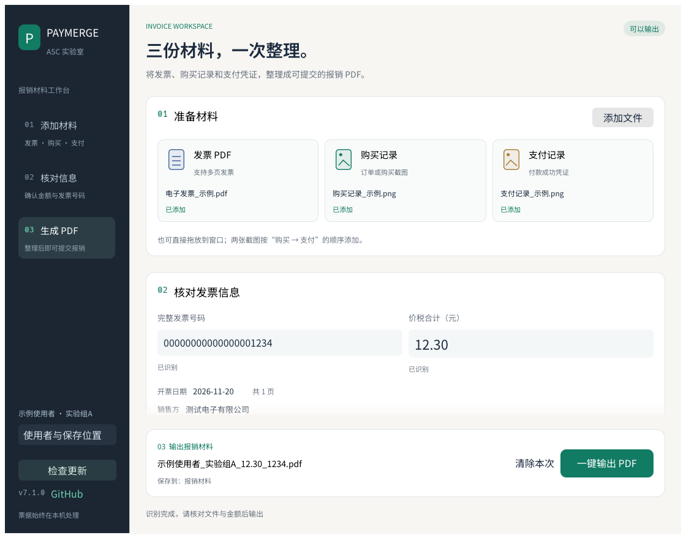

# PayMerge-PDF

Windows 发票三合一桌面工具。将一份 PDF 发票、购买记录和支付记录整理成 A4 报销材料；使用 Rust 实现，免安装，无需 Python。

[下载 Windows x64 发布包](https://github.com/ZhangStudyLife/PayMerge-PDF/releases/latest) · [使用说明](docs/使用说明.md) · [7.1 测试报告](docs/7.1-测试报告.md)



## 使用

解压完整 ZIP，运行 `ASC_InvoiceMergeTool.exe`，保留同目录的 `PayMergeUpdater.exe`、`pdfium.dll` 和 `licenses`。首次填写姓名、组别和输出目录，然后添加发票与两张截图，核对金额和完整票号，点击“一键输出 PDF”。

- 有文字层的电子发票按字段标签和坐标识别票号、价税合计、日期及完整销售方名称。金额、票号可更正；缺失或冲突时需补填并确认。
- 图片型 PDF 通过人工填写金额和票号完成输出，不包含 OCR。
- 保留所有发票页，按 A4、300 DPI、10 mm 边距等比排布，最后一张发票与两张截图共页。
- 文件名为“姓名_组别_金额_票号后四位.pdf”，重名可覆盖、添加序号或取消。
- 票据在本机处理。网络仅用于检查和下载公开程序更新，不上传票据、配置或识别内容。

## 版本更新

程序启动时、运行期间每 6 小时自动检查本仓库的 GitHub Releases；侧栏也可手动检查。发现新版后点击“下载更新”，核对更新说明，再点击“重启并升级”。只跟踪正式 Release，不跟踪每次源码提交。

下载包与 GitHub 提供的 SHA256 核对，解压后逐项核对随包清单。独立 Rust 升级程序等待主程序退出后替换程序文件，启动新版校验版本和 PDFium；失败时恢复旧文件。`config.json` 和已输出的 PDF 不参与替换。有待处理材料时需先输出或清除，才能重启升级。断网不会影响合并。

7.0 及更早版本没有内置更新入口，首次需手动下载 7.1 或更新版本，将原 `config.json` 复制到新程序旁。

维护者发布新版时，先更新 `Cargo.toml` 版本号并构建，在本仓库创建对应的 `vX.Y.Z` 正式 Release，上传 `dist/PayMerge-PDF-X.Y.Z-windows-x64.zip` 及其 `.sha256` 文件。GitHub 生成 ZIP 的 SHA256 后，客户端即可发现并校验该版本。

## 构建

开发与 Windows 交叉编译在 Linux x64 服务器完成。工具链、依赖缓存、临时目录和产物均留在项目目录，不修改全局 shell 配置。需要已有 Python 3.9+、curl、tar、xz 和系统 C 编译环境。

```bash
bash scripts/setup.sh
source scripts/env.sh
bash scripts/check.sh
bash scripts/build.sh
```

固定 Rust 1.100.0、LLVM-MinGW 20261117 UCRT、目标 `x86_64-pc-windows-gnullvm`、eframe 0.37.0、pdfium-render 0.9.5 和 PDFium 8125；其他依赖由 `Cargo.lock` 锁定。发布启用优化、LTO 和符号剥离。产物及 SHA256 文件位于 `dist/`。下载脚本遵循进程的 `HTTPS_PROXY`。

`src/` 包含界面、识别、合成和升级代码。`scripts/package_licenses.py` 汇集正式依赖、PDFium 和字体许可。`examples/` 为开发验收入口，不进入发布包。

## 验证

服务器执行 `scripts/check.sh` 完成格式、核心测试及两个目标的 Clippy。执行 `scripts/build-windows-tests.sh` 后，在 Windows 的项目映射目录运行 `scripts/test_windows.ps1`，直接运行服务器生成的原生测试程序，无需安装 Windows 编译环境。

界面预览通过 `egui_kittest` 离屏 GPU 渲染生成，仅使用合成的示例字段；测试不使用 Computer Use、桌面自动化或系统鼠标键盘注入。原生文件对话框和系统拖放的实际交互需人工验收。

真实票据验收只对用户指定的只读目录制作隔离副本：`python scripts/prepare_samples.py prepare <样例目录>`。服务器运行 `scripts/setup-validation.sh`、构建 `acceptance` 示例并运行 `scripts/acceptance_server.py`。完成或失败后运行 `python scripts/prepare_samples.py cleanup`，再次核对原件 SHA256 并清理副本、输出和字段明细。真实票据、个人配置、开发缓存及原 Python 迁移参考均不入库。
